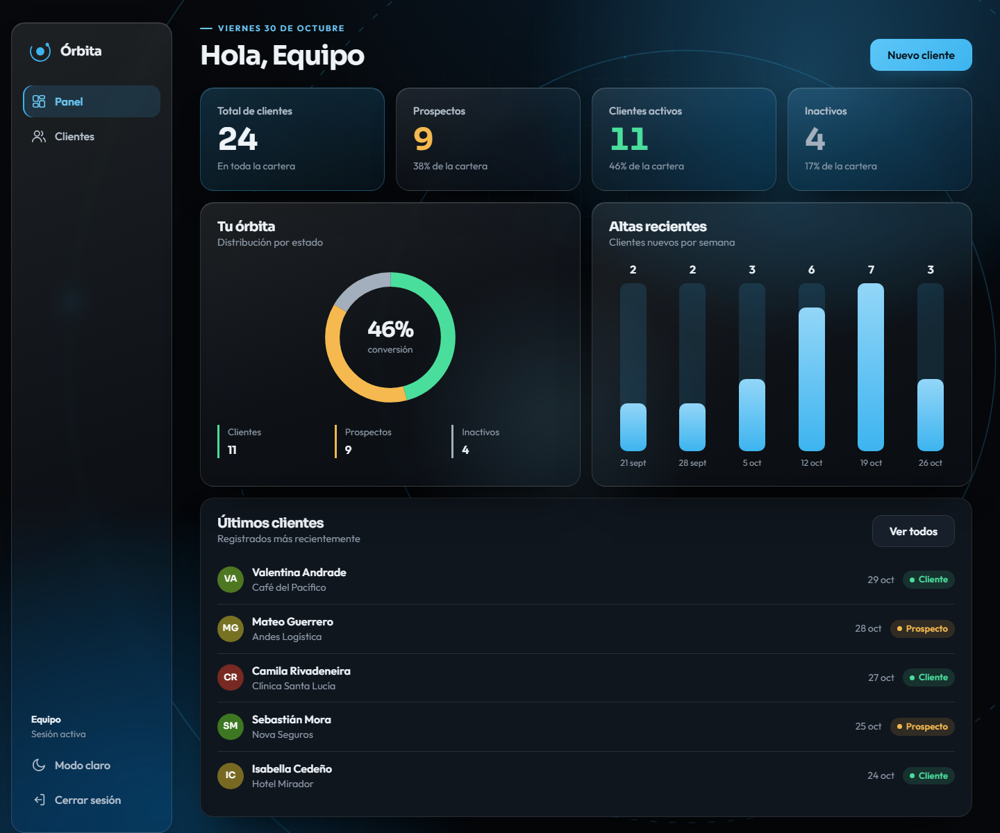
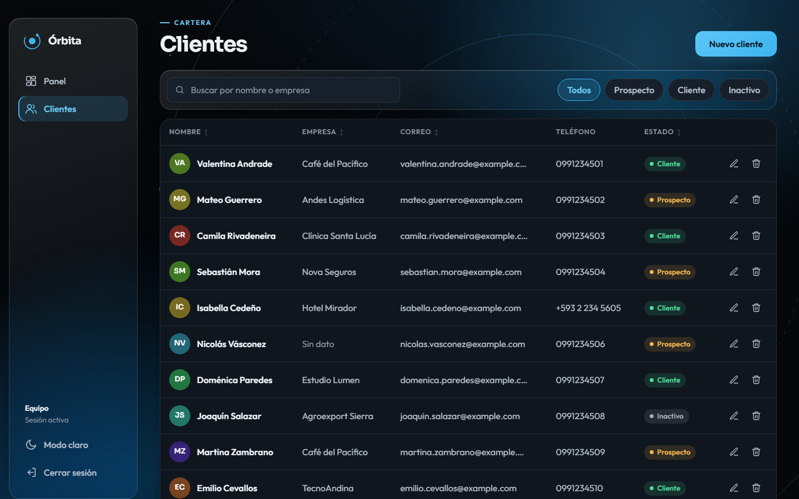
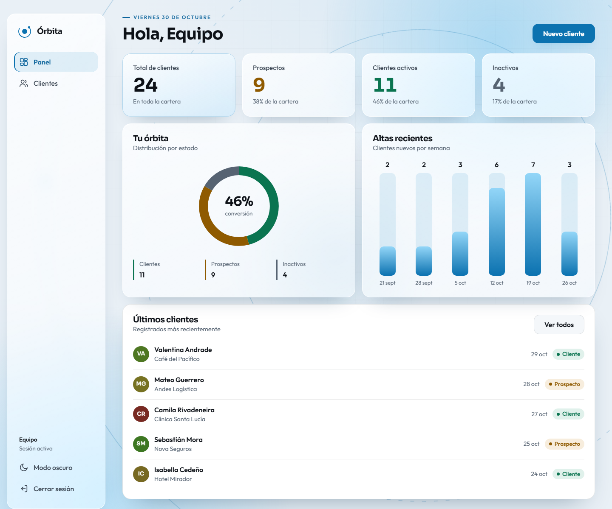
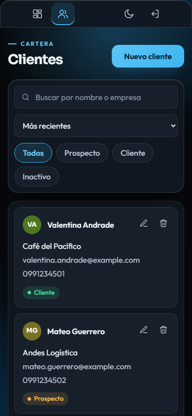

# Órbita CRM

Mini CRM de clientes hecho con Django y JavaScript Vanilla, como desafío técnico para la
vacante de Desarrollador/a de Software Junior en CEO Marketing.

[](https://github.com/SrLycan/MiniCRM/actions/workflows/ci.yml)



## Funciones

- Login con sesiones de Django y bloqueo temporal tras 5 intentos fallidos.
- Panel con métricas, distribución por estado y altas por semana, en SVG sin librerías.
- Crear, editar y eliminar clientes en modales, sin recargar la página.
- Búsqueda dinámica por nombre o empresa, sin distinguir mayúsculas ni acentos.
- Filtro por estado, orden por columnas y paginación, conservados en la URL.
- Validación inmediata en el navegador y validación definitiva en el backend.
- Mensajes toast, esqueletos de carga y estados vacío y de error con reintento.
- Modo oscuro y claro, diseño responsive de 360 a 1920 px.
- Administración de clientes desde Django Admin.

## Requisitos

- **Con Docker (recomendado):** Docker con Docker Compose.
- **Sin Docker:** Python 3.13.

## Ejecutar con Docker

```bash
git clone https://github.com/SrLycan/MiniCRM.git
cd MiniCRM
cp .env.example .env
docker compose up --build
```

Abre <http://localhost:8000> e inicia sesión. Las migraciones y los datos demo se aplican
solos, y la base de datos se conserva en un volumen de Docker.

| Usuario | Contraseña |
|---|---|
| `demo` | `Orbita-Demo-2026` |

La misma cuenta entra a Django Admin en <http://localhost:8000/admin/>.

Para detener la aplicación usa `docker compose down`. Agrega `-v` si además quieres borrar
los datos.

## Ejecutar sin Docker

```bash
python -m venv .venv
source .venv/bin/activate        # Windows: .venv\Scripts\activate
pip install -r requirements.txt
cp .env.example .env             # Windows: copy .env.example .env
python manage.py migrate
python manage.py seed_demo
python manage.py runserver
```

Abre <http://127.0.0.1:8000> y usa las mismas credenciales.

## Pruebas

```bash
python manage.py check
python manage.py test     # backend
npm test                  # funciones de JavaScript; requiere Node.js 22 o superior
```

Cada push a `main` o `develop`, y cada pull request, ejecuta en GitHub Actions el `check`,
la revisión de migraciones, ambas pruebas y la construcción de la imagen Docker.

## Estructura

```
config/       Configuración de Django
accounts/     Login y bloqueo por intentos
clients/      Modelo, formulario, vistas, URLs, admin, datos demo y pruebas
templates/    Plantillas compartidas
static/css/   Tokens, fondo, estructura, componentes y páginas
static/js/    core (API y utilidades), ui, features y pages
tests/js/     Pruebas de JavaScript
docker/       Script de arranque del contenedor
docs/         Spec, plan, decisiones y capturas
```

## API

Todas las rutas exigen sesión y responden 401 sin ella.

| Método y ruta | Uso |
|---|---|
| `GET /api/clients/?q=&status=&sort=&page=` | Listar, buscar, filtrar, ordenar y paginar |
| `POST /api/clients/` | Crear |
| `GET /api/clients/<id>/` | Consultar |
| `PUT /api/clients/<id>/` | Actualizar |
| `DELETE /api/clients/<id>/` | Eliminar |
| `GET /api/clients/stats/` | Métricas del panel |

## Decisiones técnicas

- **Sin frameworks de frontend ni DRF.** Módulos ES nativos y vistas de Django bastan para
  este alcance, y no hay paso de compilación.
- **El cristal enmarca, lo sólido se lee.** El glassmorphism va en navegación y métricas;
  la tabla, los formularios y los modales usan superficies sólidas con contraste AA.
- **Reglas críticas en la base de datos.** El correo único y los estados válidos también
  son restricciones de SQLite, y `ClientForm` traduce los errores a mensajes claros.
- **Seguridad básica.** CSRF en toda escritura, secretos por variables de entorno, datos
  pintados con `textContent` para evitar XSS y contenedor sin usuario root.

El detalle está en [docs/SPEC.md](docs/SPEC.md), [docs/PLAN.md](docs/PLAN.md) y
[docs/DECISIONES.md](docs/DECISIONES.md).

## Limitaciones conocidas

- Las credenciales de `.env.example` son solo para esta demo. Fuera de ella, cambia la
  clave secreta y la contraseña, y pon `DEMO_LOGIN_HINT=false`.
- El login de Django Admin no tiene el bloqueo por intentos de la aplicación.
- Las fuentes Sora y Outfit se cargan desde Google Fonts; sin internet se usa una fuente
  del sistema.

## Capturas

| Clientes | Modo claro | Móvil |
|---|---|---|
|  |  |  |

## Uso de IA

Desarrollado con apoyo de Claude Code, por eso algunos commits lo incluyen como coautor.
El diseño de la solución se definió primero en un spec y un plan revisados por el autor.
